<div align="center">

# universal-panel

**A slide-in side panel for Windows 11, built for reverse engineers and power users.**

Press <kbd>Alt</kbd> + <kbd>`</kbd> from anywhere. A panel slides in from the right edge with a process
explorer, your RE tools, and a terminal, all wired together.


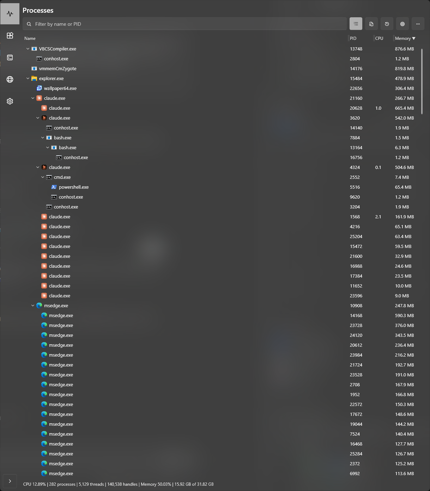

</div>

---

## Contents

- [Features](#features)
  - [Processes](#processes)
  - [Tools](#tools)
  - [Terminal](#terminal)
  - [Settings](#settings)
- [Usage](#usage)
- [Build](#build)
- [Where things are stored](#where-things-are-stored)
- [Project layout](#project-layout)
- [Contributing](#contributing)

## Features

| Module | What it does |
|---|---|
| **Processes** | Live process tree with CPU, memory and icons. Per-process details: threads, modules with signatures, handles, memory regions, strings, dumps |
| **Tools** | A launcher for your RE tools (IDA, Ghidra, x64dbg, DIE, PE-bear, System Informer and more) that finds them for you and runs them on any process or module |
| **Terminal** | PowerShell, Command Prompt, WSL distros and Python in tabs, using Windows Terminal's renderer |
| **Network** | Coming soon |
| **Settings** | Hotkey, start with Windows, refresh rate, which monitor, panel width |

The panel costs nothing while hidden: the process list samples once per second only while it's on
screen (about 2.5% of one core while open, 0 while hidden).

### Processes

A live process list as a parent/child tree or a flat list, with app icons, filtering by name or PID,
sorting, and system totals in the footer.

Right-click any process to end, suspend or resume it, change its priority, create a full or mini
dump, open its file location, or hand it to one of your tools (**Open with ›**) or a shell
(**Terminal ›**). Critical system processes get an explicit warning before you end them.

<p align="center">
  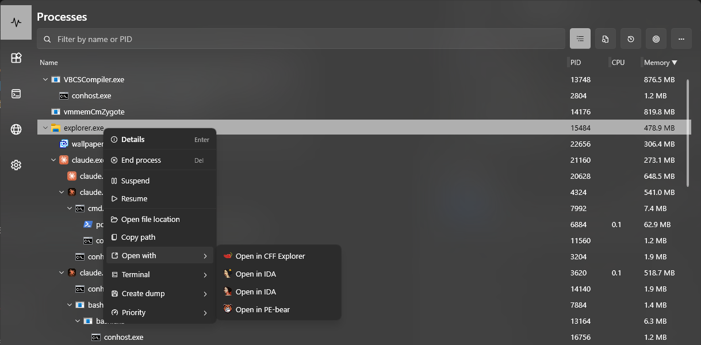
</p>

Double-click a process (or press <kbd>Enter</kbd>) for its details page.

**General** shows identity and security info at a glance: user, integrity level, architecture, command
line, protection, exploit mitigations, privileges, environment, and the compiler, linker and packer
as detected by [Detect It Easy](https://github.com/horsicq/DIE-engine).

<p align="center">
  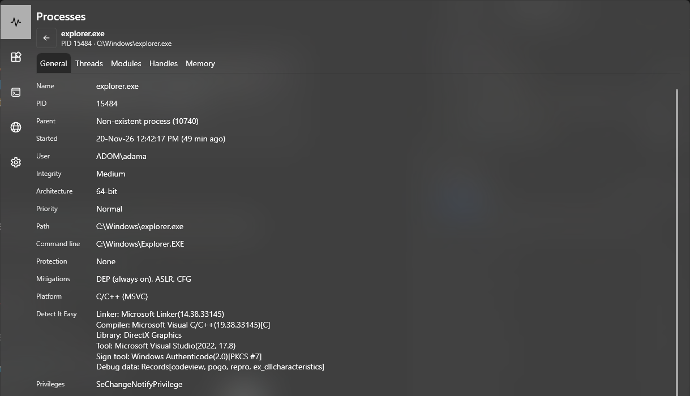
</p>

<table>
  <tr>
    <td width="50%">
      <b>Threads</b>: live, with start addresses resolved to <code>module+offset</code>. Suspend, resume or end single threads.<br><br>
      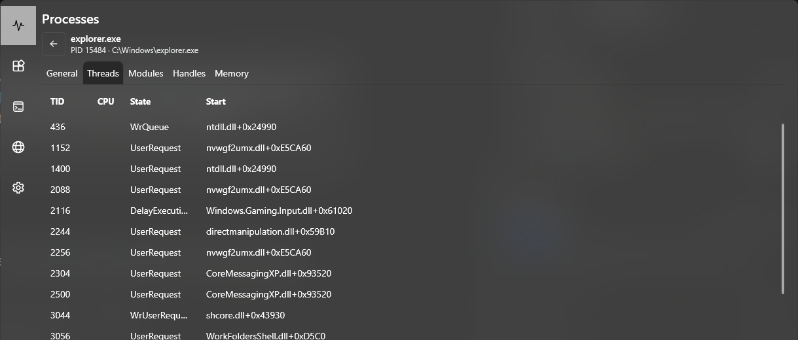
    </td>
    <td width="50%">
      <b>Modules</b>: every loaded DLL with base, size and Authenticode / catalog signer. PE header details per module.<br><br>
      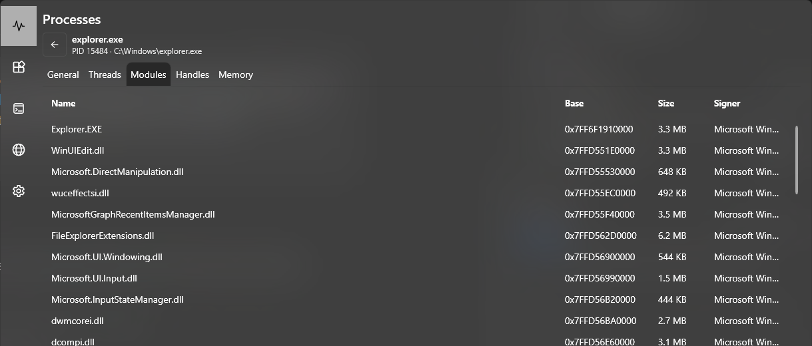
    </td>
  </tr>
  <tr>
    <td width="50%">
      <b>Handles</b>: with friendly names, a filter, and "hide unnamed". Close a handle from the right-click menu.<br><br>
      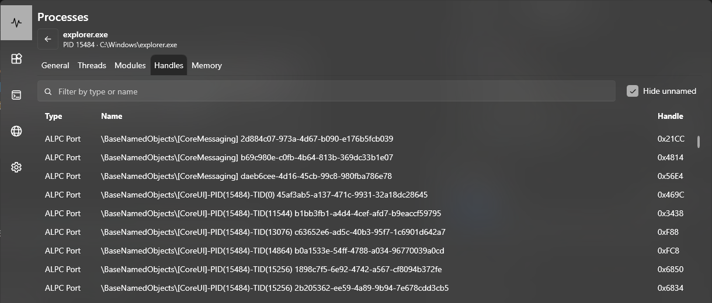
    </td>
    <td width="50%">
      <b>Memory</b>: walk every region (with an "Only suspicious" filter), search a region or the whole process for strings, and dump memory.<br><br>
      <b>Also in the toolbar:</b> find which process owns a window, search for a handle or DLL across all processes, a start/exit history, and start a program suspended.
    </td>
  </tr>
</table>

### Tools

Your tools as tiles, grouped in collapsible sections (a tool can sit in several), with search and
category filters. **Find installed** scans for known tools such as IDA, Ghidra, x64dbg, Detect It
Easy, System Informer, PE-bear and CFF Explorer, including command-line tools on Windows and inside
WSL distros, and lets you pick what to add. Each tile shows the version and a badge for whether the
publisher signed it (shield) or it was only identified from its version info (check mark).

<p align="center">
  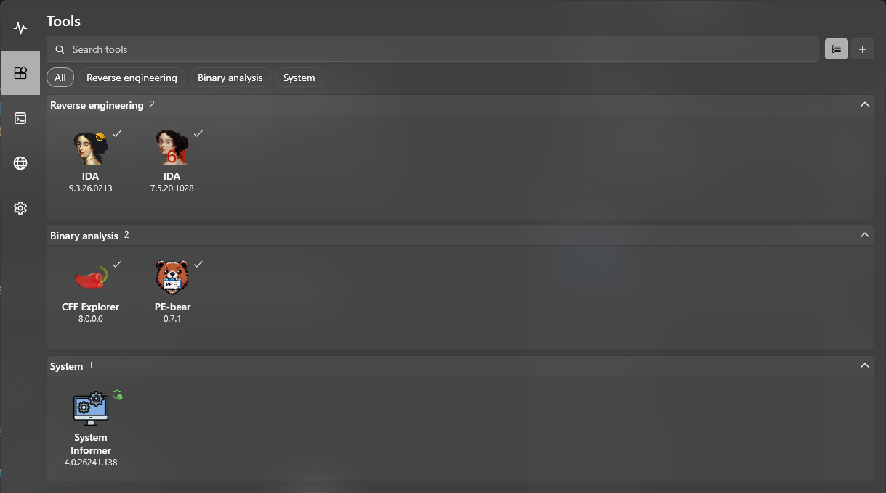
</p>

Every tool has editable **actions** (for example *Attach x64dbg* or *strings*) with a live preview of
the command they'll run. Actions show up under **Open with ›** on processes and modules; command-line
actions run in a Terminal tab.

<p align="center">
  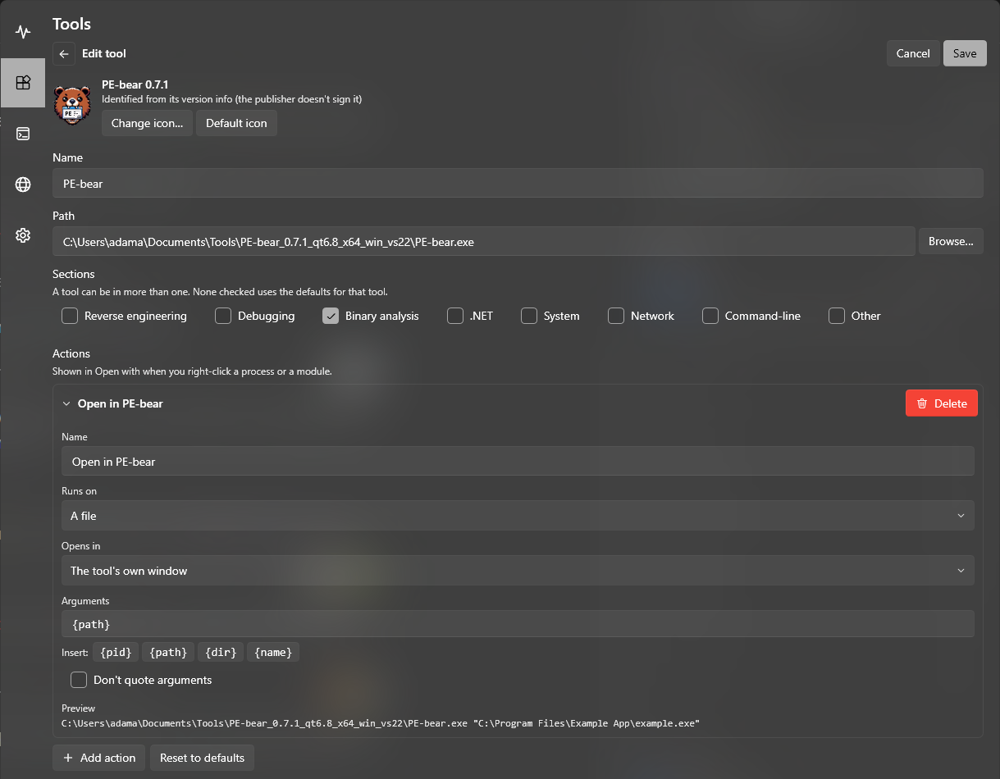
</p>

Tools always open unelevated, even from an elevated panel. Default actions live in
[`known-tools.json`](src/UniversalPanel/Catalog/known-tools.json); see [docs/TOOLS.md](docs/TOOLS.md)
to add tools or change arguments.

### Terminal

PowerShell, Command Prompt, each WSL distro and Python, in tabs with their own icons, rendered by
Windows Terminal's control. Shells keep running while the panel is hidden and tabs reopen after a
restart.

<p align="center">
  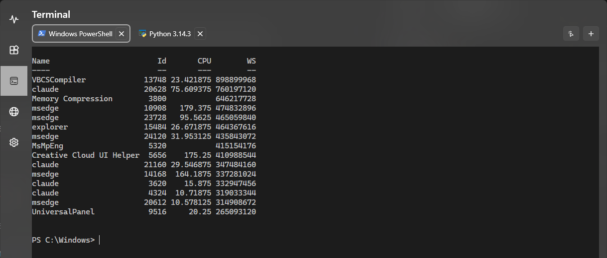
</p>

- **Terminal ›** on a process or module opens a shell in its folder, or pastes its path (quoted for
  that shell, converted for WSL) or PID into the open tab.
- Select a PID or a path in a terminal's output and jump to it in Processes or open it with a tool.
- Right-click a tab to see its shell, and what it started, in Processes.
- Shells run with your normal rights. From an elevated panel, **Run as administrator** in the
  <kbd>+</kbd> menu (or <kbd>Shift</kbd>+click) opens an admin tab, marked with a shield.

<p align="center">
  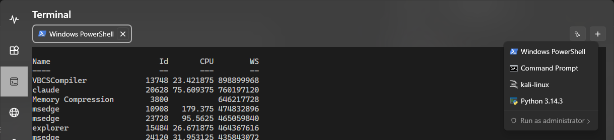
</p>

### Settings

<p align="center">
  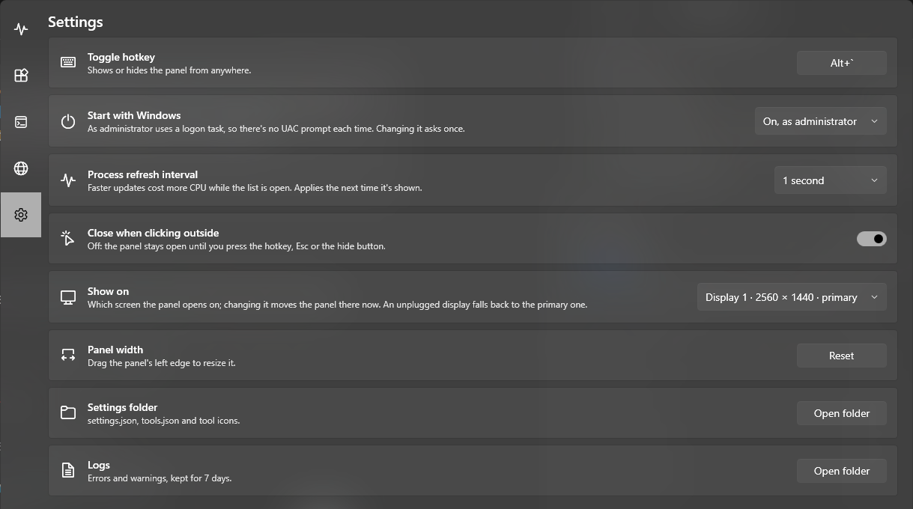
</p>

## Usage

| Action | How |
|---|---|
| Toggle panel | <kbd>Alt</kbd> + <kbd>`</kbd>, or left-click the tray icon |
| Hide | <kbd>Esc</kbd>, click outside, or the `>` button |
| Resize | Drag the panel's left edge |
| Process actions | Right-click a process; <kbd>Del</kbd> ends the selected one (after confirming) |
| Process tree | Click the arrow, or <kbd>Right</kbd> / <kbd>Left</kbd> to expand / collapse (<kbd>Left</kbd> again jumps to the parent). Header clicks sort children within each parent; a third click returns to creation order. Typing a filter shows a flat list |
| Process details | Double-click or <kbd>Enter</kbd>; <kbd>Backspace</kbd> or the back button returns |
| Run a tool | Double-click its tile, or **Open with ›** on a process or module |
| Rename a terminal tab | Double-click it |
| Logs / exit | Right-click the tray icon |
| Administrator | Tray > **Restart as administrator**. Elevated, the panel enables `SeDebugPrivilege` so services and other users' processes can be inspected and managed |

Without elevation, actions on other users' and protected processes fail with "access denied", by
design.

## Build

Requires Windows 11 x64 and the [.NET 10 SDK](https://dotnet.microsoft.com/download).

```bash
git clone https://github.com/0xKNUCKS/universal-panel.git
cd universal-panel
dotnet build -c Release
```

Or run `build.bat`, which closes a running panel first. The output is in
`src/UniversalPanel/bin/Release/net10.0-windows/win-x64/`.

The first build downloads [Detect It Easy](https://github.com/horsicq/DIE-engine) 3.21 (about 25 MB,
cached in `obj/`) and checks it against a pinned SHA-256; see `third_party/die/Die.targets`.
Offline, the build still succeeds and the panel runs without it. `-p:SkipDie=true` skips it.

## Where things are stored

Everything lives in `%LOCALAPPDATA%\UniversalPanel` (Settings > Settings folder, or the tray menu):

| Path | Contents |
|---|---|
| `settings.json` | Preferences and UI state |
| `tools.json` | Your tools and their actions |
| `icons\` | Copies of the icons you picked for tools |
| `logs\` | Errors and warnings, kept for 7 days |

## Project layout

```
src/UniversalPanel/
  App.xaml(.cs)      startup, single instance, tray, global error handlers
  Shell/             panel window, animation, hotkey, single-instance IPC
  Modules/           IPanelModule contract + Processes, Tools, Terminal, Settings
  Catalog/           known-tools.json (tool recognition and default actions)
  Diagnostics/       Log, ErrorReporter, Guard (error boundaries)
  Native/            Win32 helpers (P/Invoke generated by CsWin32 from NativeMethods.txt)
docs/
  DESIGN.md          goals and design principles (secure, user-friendly, open source)
  SECURITY.md        applied hardening + rules for new modules
  PITFALLS.md        known traps per module
  TOOLS.md           adding tools and actions
  REFERENCES.md      which upstream code each file mirrors (repo, commit, license)
```

<details>
<summary><b>Error handling in one paragraph</b></summary>

Every caught exception goes to `ErrorReporter.Report(ex, context)`, which classifies it (fatal
exceptions are never swallowed; known-harmless DWM exceptions are only logged), logs full details
once per burst, de-duplicates repeats, and shows it in the panel's notice bar with a repeat count.
Feature edges (module lifecycle, timer ticks, handlers, fire-and-forget tasks) are wrapped in
`Guard.Run` / `Guard.RunAsync` / `task.Forget(context)`, so one failing module shows an error view
instead of crashing the app. Uncaught UI exceptions are handled the same way, unless they arrive
faster than 50 per 10 s, in which case the app logs and exits rather than spinning.

</details>

## Contributing

Contributions are welcome. Read [CONTRIBUTING.md](CONTRIBUTING.md) first; it covers the design
principles, security rules and commit format.

## Acknowledgements

Built with [WPF-UI](https://github.com/lepoco/wpfui), [H.NotifyIcon](https://github.com/HavenDV/H.NotifyIcon),
[NHotkey](https://github.com/thomaslevesque/NHotkey), [CsWin32](https://github.com/microsoft/CsWin32),
the [Windows Terminal](https://github.com/microsoft/terminal) control and
[Detect It Easy](https://github.com/horsicq/DIE-engine). See [THIRD_PARTY_NOTICES.md](THIRD_PARTY_NOTICES.md).
